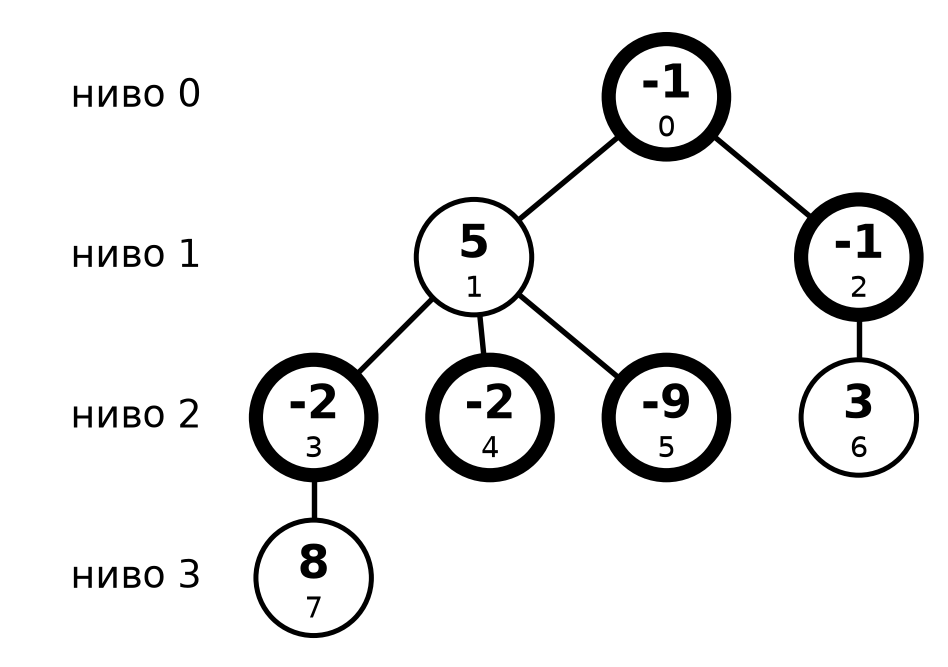

# Контролно 3 СДА 2026/27

## Задача 1: Най-близка стойност в BST (100 точки)

Дадено е двоично наредено дърво (BST) с ***N*** върха и цяло число ***target***. Стойността *target* може, но не е задължително, да е част от дървото.

Напишете функция, която връща стойността в дървото, която е **най-близка** до *target*. Ако има няколко такива стойности, върнете **най-малката**.

**C++:**

```cpp
struct TreeNode {
    int value;
    TreeNode* left;
    TreeNode* right;
};

int closestValue(TreeNode* root, int target);
```

**Python:**

```python
class TreeNode:
    def __init__(self, value, left=None, right=None):
        self.value = value
        self.left = left
        self.right = right

def closestValue(root, target):
    pass
```

Обяснете в 1-2 изречения сложността по време и памет.

### Ограничения

- 1 ≤ *N* ≤ 200 000
- Стойностите във върховете и *target* са цели числа в интервала [-10^9, 10^9]
- Всички стойности в дървото са различни

### Пример

Дърво:

```
      8
     / \
    2   10
   / \
  1   6
```

Вход: `root = [8, 2, 10, 1, 6]`, `target = 4`

Изход: `2`

*Обяснение:* за target = 4 стойностите 2 и 6 са на разстояние 2, затова се връща по-малката, 2.

### Решения

Решения може да видите [тук](Solutions/Task1).

---

## Задача 2: Отрицателните по нива (100 точки)

Дадено е дърво с ***N*** върха, номерирани от 0 до *N* - 1. Коренът е винаги върхът с номер 0, а всеки връх *i* пази цяло число *A<sub>i</sub>*. Нивото на един връх е броят на ребрата от корена до него: коренът е на ниво 0, децата му са на ниво 1 и така нататък. Един връх може да има произволен брой деца.

Напишете програма, която прочита дървото и извежда за всяко ниво **отрицателните** стойности на върховете от него.

- Всяко ниво е на нов ред във вида `Ниво X: a b c`, а стойностите са в произволен ред. Ниво без отрицателни стойности не се извежда.
- Обяснете в 1-2 изречения сложността по време и памет.

### Вход

- На първия ред са числата *N* и *E*.
- На втория ред са *N* числа: *A<sub>0</sub>*, *A<sub>1</sub>*, ..., *A<sub>N-1</sub>*.
- Следват *E* реда с по две числа „родител дете". Ребрата са подредени така, че първо идват `0 1`, `0 2`, ..., след това ребрата на връх 1 и т.н. Родителят винаги има по-малък номер от детето.

### Ограничения

- 1 ≤ *N* ≤ 200 000
- *E* = *N* - 1
- -10^9 ≤ *A<sub>i</sub>* ≤ 10^9

### Пример

Вход:

```
8 7
-1 5 -1 -2 -2 -9 3 8
0 1
0 2
1 3
1 4
1 5
2 6
3 7
```

Изход:

```
Ниво 0: -1
Ниво 1: -1
Ниво 2: -2 -2 -9
```

Дървото от примера:



На чертежа върховете с отрицателна стойност са с удебелена рамка. Малкото число във всеки връх е неговият номер.

*Обяснение:* на ниво 2 стойността -2 се среща два пъти и се извежда два пъти. На ниво 1 стойността 5 не е отрицателна. На ниво 3 има само 8, затова за него няма ред.

### Решения

Решения може да видите [тук](Solutions/Task2).
