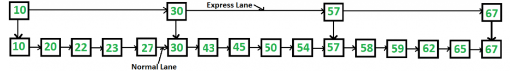

# Упражнение 4

## Темата включва

- Едносвързан списък
- Двойносвързан списък
- Array vs Linked list
- Задачи
- Бонус

## Свързан списък

**Note:** В папка LinkedLists може да намерите имплементации на структурите.

За Python версии може да разгледате GitHub хранилището [TheAlgorithms](https://github.com/TheAlgorithms/Python) и неговия подраздел [LinkedLists](https://github.com/TheAlgorithms/Python/tree/master/data_structures/linked_list). По-опростени версии има в playground-а от семинара.

### Какво е абстрактна структура от данни
Абстрактната структура от данни (абстрактен тип данни) дава определена дефиниция (абстракция) на конкретната структура, т.е. определя допустимите операции и свойства, без да се интересува от конкретната реализация. Това позволява един абстрактен тип данни да има различни реализации и съответно различна ефективност.

[List](https://en.wikipedia.org/wiki/List_(abstract_data_type)) е абстрактна структура от данни. Никой не ни задължава имплементацията отзад да е масив или linked list, стига да е спазен интерфейсът.

### Какво е свързан списък
Линейна структура от данни, чиито елементи не е задължително да са наредени последователно в паметта, а всеки елемент има указател към следващия.


Има различни имплементации:
- с опашка
- без опашка
- singly
- doubly

Кога бихме го използвали и защо ни е Linked list:
- Всичко, изискващо Next/Prev функционалност
- Специфични задачи с много добавяния (в началото и края) и конкатенации на списъци
- Да разберем поинтърите
- Използва се в други по-сложни структури от данни

### Представяне в паметта

| Array                                                                                                                               | LinkedList                                                                                                                          |
| ----------------------------------------------------------------------------------------------------------------------------------- | ----------------------------------------------------------------------------------------------------------------------------------- |
|  |  |

| Inserting a node                                                                                                                    | Removing a node                                                                                                                     |
| ----------------------------------------------------------------------------------------------------------------------------------- | ----------------------------------------------------------------------------------------------------------------------------------- |
|  |  |

### Преглед на имплементация на Singly linked list (Едносвързан списък)

**Note:** Никой не ни пречи във всяка от имплементациите да добавим и size на колекцията.

Класическата имплементация на възел от едносвързан списък:

<details>
  <summary>C++</summary>

```c++
template<typename T>
struct Node {
  T value;
  Node* next;

  Node(const T& value, Node* next = nullptr)
    : value(value), next(next) { }
};
```

</details>

<details>
  <summary>Python</summary>

```python
class Node:
    def __init__(self, data=0, next_=None):
        self.data = data
        self.next_ = next_ 
```

</details>

---

Тази структура може да се обвие в клас, който да представлява свързан списък. Свързаният списък държи указател към първия node, а за оптимизация и по-бързо добавяне в края ще пазим указател и към последния.


<details>
  <summary>C++</summary>

```c++
template<typename T>
class SinglyLinkedList {
private:
	struct Node {
		T value;
		Node* next;

		Node(const T& value, Node* next = nullptr)
			: value(value), next(next) { }
	};

	Node* head, * tail;
public:
....
};

```

</details>

<details>
  <summary>Python</summary>


```python
class LinkedList:
    def __init__(self, head=None, tail=None):
        self.head = head 
        self.tail = tail
```

</details>

---

Опашката дава възможност за добавяне на елемент за константно време в края на списъка:

<details>
  <summary>C++</summary>

```c++
template <typename T>
void SinglyLinkedList<T>::push_back(const T& value) {
	Node* newNode = new Node(value);

	if (!head) {
		head = tail = newNode;
	}
	else {
		tail->next = newNode;
		tail = tail->next;
	}
}
```

</details>

<details>
  <summary>Python</summary>

```python
class LinkedList:
    # ...
    def push_back(self, data):
        new_node = Node(data)

        if not self.head:
            self.head = self.tail = new_node
        else:
            self.tail.next_ = new_node
            self.tail = new_node
```

</details>

---

Добавяне на елемент в началото на списъка става за константно време:


<details>
  <summary>C++</summary>
	
```c++
template<typename T>
void SinglyLinkedList<T>::push_front(const T& value) {
	Node* newNode = new Node(value);

	if (!head) {
		head = tail = newNode;
	}
	else {
		newNode->next = head;
		head = newNode;
	}
}
```

</details>

<details>
  <summary>Python</summary>

```python
class LinkedList:
    # ...
    def push_front(self, data):
        new_node = Node(data)

        if not self.head:
            self.head = self.tail = new_node
        else:
            new_node.next_ = self.head
            self.head = new_node
```

</details>

---

Обхождане на свързан списък:


<details>
  <summary>C++</summary>

```c++
template<typename T>
void SinglyLinkedList<T>::print() const {
	Node* iter = head;

	while (iter) {
		std::cout << iter->value << " ";
		iter = iter->next;
	}

	std::cout << "\n";
}
```

</details>

<details>
  <summary>Python</summary>


```python
class LinkedList:
    # ...
    def print(self):
        current = self.head

        while current:
            print(current.data)
            current = current.next_
```

</details>

---

Изтриване на елемент в **началото** на списъка - **константна** сложност:

<details>
  <summary>C++</summary>

```c++
template<typename T>
void SinglyLinkedList<T>::pop_front() {
	if (!head) {
		throw std::length_error("List is empty");
	}

	Node* temp = head;
	head = head->next;
	delete temp;

	// in case we had only one element
	if (!head) {
		tail = nullptr;
	}
}
```

</details>

<details>
  <summary>Python</summary>

```python
class LinkedList:
    # ...
    def pop_front(self):
        if self.head == self.tail:
            self.head = self.tail = None
        else:
            self.head = self.head.next_ 
```

</details>

---

Изтриване на елемент в **края** на списъка - **линейна** сложност, понеже нямаме директен достъп до предпоследния елемент!

<details>
  <summary>C++</summary>

```c++
template<typename T>
void SinglyLinkedList<T>::pop_back() {
	if (!head) {
		throw std::length_error("List is empty");
	}

	Node* prev = nullptr;
	Node* iter = head; // iter will be pointing to the last element after the loop
	while (iter != tail) {
		prev = iter;
		iter = iter->next;
	}

	if (iter == head) { // in case we had only one element
		head = tail = nullptr;
	}
	else {
		prev->next = nullptr;
		tail = prev;
	}

	delete iter;
}
```

</details>

<details>
  <summary>Python</summary>

```python
class LinkedList:
    # ...
    def pop_back(self):
        if self.head == self.tail:
            self.head = self.tail = None
        else:
            current = self.head
            while current.next_ != self.tail:
                current = current.next_

            current.next_ = None 
            self.tail = current
```

</details>

## Двойносвързан списък

Всеки възел съхранява указатели към елементите преди и след него. Това позволява обхождане на списъка и в обратна посока.
Класическата имплементация на възел от двойносвързан списък:

<details>
  <summary>C++</summary>

```c++
template<typename T>
class DoublyLinkedList {
private:
	struct Node {
		T value;
		Node* prev, * next;

		Node(const T& value, Node* prev = nullptr, Node* next = nullptr)
			: value(value), prev(prev), next(next) { }
	};

	Node* head, * tail;
	size_t length = 0;
public:
...
};
```

</details>

<details>
  <summary>Python</summary>


```python
class Node:
    def __init__(self, data, next_=None, prev=None):
        self.data = data
        self.next_ = next_
        self.prev = prev

class DoublyLinkedList:
    def __init__(self, head=None, tail=None):
        self.head = head 
        self.tail = tail
```
</details>
<br>

Имплементацията не се различава особено от тази на SinglyLinkedList, освен по това, че трябва правилно да нагласяме prev и next на всеки елемент.
Важно е да споменем, че в този случай премахването на елемент в края на списъка може да бъде постигнато за константно време.

---

Премахване на елемент в края на списъка - **константно** време:

<details>
  <summary>C++</summary>

```c++
template<typename T>
void DoublyLinkedList<T>::pop_back() {
	if (!tail) {
		throw std::length_error("List is empty");
	}

	Node* toDelete = tail;
	if (head == tail) {
		head = tail = nullptr;
	}
	else {
		tail = tail->prev;
		tail->next = nullptr;
	}

	delete toDelete;
	length--;
}
```

</details>

<details>
  <summary>Python</summary>

```python
class DoublyLinkedList:
    # ...
    def pop_back(self):
        if self.head == self.tail:
            self.head = self.tail = None
        else:
            self.tail = self.tail.prev
            self.tail.next_ = None
```

</details>
<br>

Получаваме предимството да премахнем последния елемент за константно време, но увеличаваме паметта, нужна за съхранението на структурата.

### Алтернативна имплементация със sentinel nodes

Добавят се dummy nodes в началото и края, които никога не се трият, с цел да се спестят всички проверки, свързани с head и tail.
[Doubly Linked List using Sentinel Nodes (GeeksforGeeks)](https://www.geeksforgeeks.org/dsa/doubly-linked-list-using-sentinel-nodes/)

## Linked List или Array

Предимства на Linked List:
- константно време за добавяне в началото и края (в зависимост от имплементацията);
- константно време за добавяне на елемент на произволна позиция, ако вече имаме указател към съответния възел;
- не се заделя излишна памет за резервни клетки;
- константно време за конкатенация на два списъка (при наличие на tail).

Недостатъци:
- достъпът до елемент на произволна позиция отнема линейно време;
- търсенето става за линейно време дори при сортиран списък (не можем да приложим двоично търсене);
- заделя се допълнителна памет за указателя към следващия елемент във всеки възел;
- няма locality, което на практика е от изключителна важност.

Почти винаги ще предпочитаме масив заради бързия достъп по индекс (и възможността за двоично търсене в сортиран масив) и locality.

## Complexity comparison

| Operation / Data structure | Array             | Singly linked list without tail | Singly linked list with tail | Doubly linked list without tail | Doubly linked list with tail |
| -------------------------- | ----------------- | ------------------------------- | ---------------------------- | ------------------------------- | ---------------------------- |
| push_front                 | $\mathcal{O}(n)$  | $\mathcal{O}(1)$                | $\mathcal{O}(1)$             | $\mathcal{O}(1)$                | $\mathcal{O}(1)$             |
| pop_front                  | $\mathcal{O}(n)$  | $\mathcal{O}(1)$                | $\mathcal{O}(1)$             | $\mathcal{O}(1)$                | $\mathcal{O}(1)$             |
| get_front                  | $\mathcal{O}(1)$  | $\mathcal{O}(1)$                | $\mathcal{O}(1)$             | $\mathcal{O}(1)$                | $\mathcal{O}(1)$             |
| push_back                  | $\mathcal{O}(1)^*$ | $\mathcal{O}(n)$                | $\mathcal{O}(1)$             | $\mathcal{O}(n)$                | $\mathcal{O}(1)$             |
| pop_back                   | $\mathcal{O}(1)$  | $\mathcal{O}(n)$                | $\mathcal{O}(n)$             | $\mathcal{O}(n)$                | $\mathcal{O}(1)$             |
| get_back                   | $\mathcal{O}(1)$  | $\mathcal{O}(n)$                | $\mathcal{O}(1)$             | $\mathcal{O}(n)$                | $\mathcal{O}(1)$             |
| get_at                     | $\mathcal{O}(1)$  | $\mathcal{O}(n)$                | $\mathcal{O}(n)$             | $\mathcal{O}(n)$                | $\mathcal{O}(n)$             |
| find_key                   | $\mathcal{O}(n)$  | $\mathcal{O}(n)$                | $\mathcal{O}(n)$             | $\mathcal{O}(n)$                | $\mathcal{O}(n)$             |
| erase_key                  | $\mathcal{O}(n)$  | $\mathcal{O}(n)$                | $\mathcal{O}(n)$             | $\mathcal{O}(n)$                | $\mathcal{O}(n)$             |
| is_empty                   | $\mathcal{O}(1)$  | $\mathcal{O}(1)$                | $\mathcal{O}(1)$             | $\mathcal{O}(1)$                | $\mathcal{O}(1)$             |
| add_before                 | $\mathcal{O}(n)$  | $\mathcal{O}(n)$                | $\mathcal{O}(n)$             | $\mathcal{O}(1)$                | $\mathcal{O}(1)$             |
| add_after                  | $\mathcal{O}(n)$  | $\mathcal{O}(1)$                | $\mathcal{O}(1)$             | $\mathcal{O}(1)$                | $\mathcal{O}(1)$             |

\* амортизирано (виж обяснението по-долу)

<details>
  <summary>Добавянето в края на динамичен масив е със сложност Amortized O(1). (Отвори за обяснение)</summary>

Амортизираната сложност е средният разход на една операция, оценен върху цяла поредица от операции.

С други думи, ако добавим само един елемент, това може да бъде много скъпо — $\mathcal{O}(n)$, но ако добавим n елемента, общата сложност ще бъде $\mathcal{O}(n)$ за добавянето на всички n елемента.

Обяснение с пример:
Нека вземем динамичен масив (в C++ това е std::vector).

В началото имаме само един празен слот. За константно време добавяме един елемент в края на масива.

Когато искаме да добавим още един елемент, масивът е запълнен, затова го удвояваме по размер (до 2 слота), копираме стария елемент в началото и за константно време добавяме новия елемент в края. Копирането изисква $\mathcal{O}(n)$ стъпки.

Искаме да добавим трети елемент, но капацитетът ни е 2, затова увеличаваме масива до 4 слота, което изисква $\mathcal{O}(n)$ стъпки, и добавяме новия елемент в края за константно време.

Искаме да добавим четвърти елемент, а капацитетът ни вече е 4, така че можем да го добавим в края за константно време.

В заключение:
Всеки път, когато искаме да добавим елемент на позиция (индекс) $2^k$, трябва да разширим масива със сложност $\mathcal{O}(2^k)$. Всички останали добавяния са със сложност $\mathcal{O}(1)$.

В крайна сметка имаме следната сума: $n \cdot 1 + (2^0 + 2^1 + 2^2 + \dots + 2^k)$, където $k = \lfloor \log_2(n - 1) \rfloor$ — по една единица за всяко добавяне плюс цената на всички копирания. Единиците дават n, а сумата от степените на двойката е $2^{k+1} - 1 < 2n$. Заключението е, че добавянето на n елемента ни струва $\mathcal{O}(n)$ време. С други думи, амортизираната сложност на добавяне на един елемент е $\mathcal{O}(1)$.
</details>

<details>
  <summary><b>C++: Linked list имплементации в STL</b></summary>

- std::list -> doubly
- std::forward_list -> singly

</details>

## Задачи

### Подходи и съвети за задачи
- Техника Two pointers – fast and slow
- Във всяка задача има много edge cases, свързани с:
	- празен list
	- това дали елементът е head или tail
	- това дали елементът е nullptr/None
- Много често задачите могат да бъдат решени по повече от един начин
- В случай че ни трябва директен достъп – да пазим масив с всички Node-ове

### Easy

- [Middle of the linked list](https://leetcode.com/problems/middle-of-the-linked-list/)
- [Linked list cycle](https://leetcode.com/problems/linked-list-cycle/)
  - [Floyd's Cycle Finding Algorithm](https://www.geeksforgeeks.org/floyds-cycle-finding-algorithm/)
- [Merge Two Sorted Lists](https://leetcode.com/problems/merge-two-sorted-lists/)
- [Remove Duplicates from Sorted List](https://leetcode.com/problems/remove-duplicates-from-sorted-list/)
- [Reverse linked list](https://leetcode.com/problems/reverse-linked-list/)
- [Replace element with ones](https://www.hackerrank.com/contests/sda-test-2022-2023-wdfgs/challenges/challenge-3729)
- [Intersection of Two Linked Lists](https://leetcode.com/problems/intersection-of-two-linked-lists/)
  
### Medium
- [Delete Node in a Linked List](https://leetcode.com/problems/delete-node-in-a-linked-list/)
  - O(1) time and space
- [Linked List Cycle II](https://leetcode.com/problems/linked-list-cycle-ii/)
  - Как да се реши с O(1) допълнителна памет?
  - [Find first node of loop in a linked list](https://www.geeksforgeeks.org/dsa/find-first-node-of-loop-in-a-linked-list/)
- [Remove Nth Node From End of List](https://leetcode.com/problems/remove-nth-node-from-end-of-list/)
- [Odd Even Linked List](https://leetcode.com/problems/odd-even-linked-list/)
- [Partition List](https://leetcode.com/problems/partition-list/)

# Бонус

## Бонус задачи
- [ZUMA - Hard](https://www.hackerrank.com/contests/sda-hw-4-2022/challenges/zuma-1)
- [Linked List Random Node](https://leetcode.com/problems/linked-list-random-node/)
- [Linked List Problems (Stanford CS Library)](http://cslibrary.stanford.edu/105/LinkedListProblems.pdf)

## XOR Linked List
Това е двойносвързан списък, който заема толкова памет, колкото един едносвързан. Всеки възел пази вместо два указателя XOR на адресите на предходния и следващия елемент. (Припомнете си как работи XOR и по-конкретно пробвайте задачата [Single Number](https://leetcode.com/problems/single-number/).)

<details>
  <summary>Как работи XOR и как с него се кодират два адреса в една променлива</summary>

XOR (`^`) сравнява числата бит по бит: резултатният бит е 1, ако двата бита са различни, и 0, ако са еднакви. Важните свойства са:

- $a \oplus a = 0$ и $a \oplus 0 = a$;
- операцията е комутативна ($a \oplus b = b \oplus a$) и асоциативна ($(a \oplus b) \oplus c = a \oplus (b \oplus c)$).

От тях следва, че $(a \oplus b) \oplus a = b$ и $(a \oplus b) \oplus b = a$. Тоест, ако пазим само $x = a \oplus b$ и знаем едното от двете числа, можем да възстановим другото.

Пример: $a = 5 = 101_2$, $b = 3 = 011_2$, $x = 110_2 = 6$, а $6 \oplus 5 = 011_2 = 3 = b$.

Адресите в паметта също са числа, затова вместо два указателя `prev` и `next` всеки възел може да пази една стойност `prev ^ next`. Когато обхождаме списъка, винаги знаем от кой възел идваме, така че `(prev ^ next) ^ prev` ни дава `next` (и аналогично в обратна посока). За краищата на списъка липсващият съсед е `nullptr`, т.е. 0, така че в `head` се пази директно адресът на следващия, а в `tail` – адресът на предходния.

</details>

---

<details>
  <summary>C++</summary>
	
```c++
template<typename T>
class XORLinkedList {
private:
	struct Node {
		T value;
		Node* nextXORPrev;

		Node(const T& value, Node* nextXORPrev = nullptr)
			: value(value), nextXORPrev(nextXORPrev) { }
	};

	Node* head = nullptr, * tail = nullptr;

	static Node* XOR(Node* a, Node* b) {
		return reinterpret_cast<Node*>(reinterpret_cast<uintptr_t>(a) ^ reinterpret_cast<uintptr_t>(b));
	}
public:
...
};
```
</details>


<details>
  <summary>Python</summary>

В момента имплементацията е в [отворен PR в TheAlgorithms/Python](https://github.com/TheAlgorithms/Python/pull/13699/files).

</details>

---

Когато искаме да достъпим следващия елемент, правим XOR на запазената стойност с адреса на предходния елемент.
Пример с обхождане на целия списък:

<details>
  <summary>C++</summary>

```c++
template<typename T>
void XORLinkedList<T>::print() const {
	Node* current = head;
	Node* prev = nullptr;
	while (current) {
		std::cout << current->value << ' ';
		// current->nextXORPrev is XOR of prev and next
		// if we XOR it with prev, we get next
		Node* next = XOR(prev, current->nextXORPrev);
		prev = current;
		current = next;
	}
}
```

</details>

---

Недостатъци:
- трудна е за имплементация;
- за да итерираме, ни трябват адресите на два съседни възела. Тоест, ако имаме само указател към един node, не можем да се придвижим нито към предишния, нито към следващия.

Още за XOR linked list: [XOR Linked List – A Memory Efficient Doubly Linked List (GeeksforGeeks)](https://www.geeksforgeeks.org/xor-linked-list-a-memory-efficient-doubly-linked-list-set-1/)

## Skip list
Skip list е сортиран свързан списък с няколко нива („express lanes“), в които всяко по-горно ниво прескача част от елементите на по-долното, благодарение на което търсенето, добавянето и изтриването стават средно за $\mathcal{O}(\log n)$.



- [Skip List (GeeksforGeeks)](https://www.geeksforgeeks.org/skip-list/)
- [Skip Lists – лекция от CMU (PDF)](https://www.cs.cmu.edu/~ckingsf/bioinfo-lectures/skiplists.pdf)
