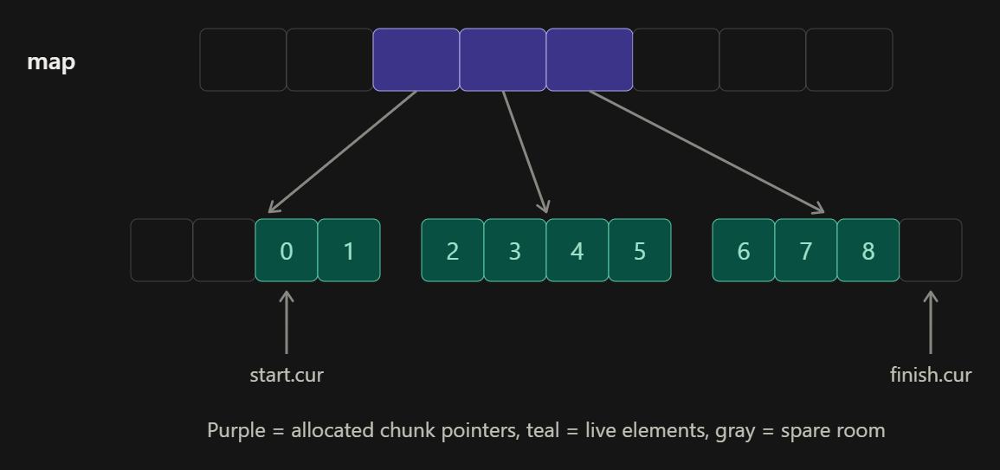
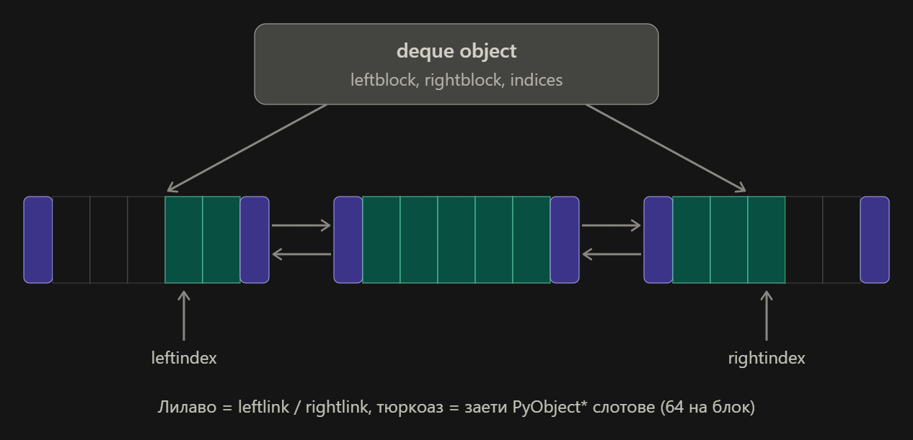

# Упражнение 5

## Темата включва

- [Queue](#queue-опашка)
- [Stack](#stack-стек)
- [Deque](#deque-дек)
- [Monotonic Stack](#monotonic-stack-монотонен-стек)
- [Sliding window](#sliding-window-плъзгащ-се-прозорец)

**Note:** В папка [Implementations](./Implementations/) може да намерите имплементации на структурите на C++.

## Queue (Опашка)
Опашката е абстрактен тип данни, който представлява колекция от елементи с три основни операции:

- push - добавя елемент в края на опашката;
- pop - премахва най-отдавна добавения елемент;
- peek - връща стойността на най-отдавна добавения елемент.

Редът, по който елементите се добавят или премахват от опашката, се описва като „първи влязъл, първи излязъл“ (на английски: First In, First Out, или съкратено FIFO).

Може да бъде имплементирана чрез:
- Linked list (с указател и към последния елемент)
- Dynamic array (Circular)

### Сравнение на имплементациите

| Queue with       | Dynamic Array                      | Linked list      |
| ---------------- | ---------------------------------- | ---------------- |
| push()/enqueue() | Amortized $\mathcal{O}(1)$         | $\mathcal{O}(1)$ |
| pop()/dequeue()  | Amortized $\mathcal{O}(1)$         | $\mathcal{O}(1)$ |
| peek()/top()     | $\mathcal{O}(1)$                   | $\mathcal{O}(1)$ |
| clear()          | $\mathcal{O}(p)$ - delete memory   | $\mathcal{O}(n)$ |
| isEmpty()        | $\mathcal{O}(1)$                   | $\mathcal{O}(1)$ |
| initialize       | $\mathcal{O}(p)$ - allocate memory | $\mathcal{O}(1)$ |

Тук $n$ е броят на елементите, а $p$ - капацитетът на масива.

### Имплементации в стандартните библиотеки
- [C++](https://en.cppreference.com/w/cpp/container/queue)
- [Python deque](https://docs.python.org/3/library/collections.html#collections.deque) - използваме дек (double-ended queue), имплементиран като двойносвързан списък от блокове. Може да се ползва и като стек, и като опашка.

### Задачи
- [Number of Recent Calls](https://leetcode.com/problems/number-of-recent-calls/)
- [Rotting Oranges](https://leetcode.com/problems/rotting-oranges/)

[Решения](./Solutions/README.md)

## Stack (Стек)
Стекът е абстрактен тип данни, който представлява колекция от елементи с три основни операции:

- push - добавя елемент на върха на стека;
- pop - премахва най-скоро добавения елемент;
- peek - връща стойността на най-скоро добавения елемент.

Редът, по който елементите се добавят или премахват от стека, се описва като „последен влязъл, първи излязъл“ (на английски: Last In, First Out, или съкратено LIFO).

Често срещани проблеми:
- Overflow - препълване на стека: добавяне на повече елементи, отколкото стекът може да побере.
- Underflow - опит за достъп до елемент или премахване на елемент от празен стек.

Може да бъде имплементиран чрез:
- Linked list
- Dynamic array

И двете имплементации се получават, като се премахнат няколко член-функции от стандартните имплементации на Linked list и Vector.

### Сравнение на имплементациите
| Stack with   | Dynamic Array                      | Linked list      |
| ------------ | ---------------------------------- | ---------------- |
| push()       | Amortized $\mathcal{O}(1)$         | $\mathcal{O}(1)$ |
| pop()        | Amortized $\mathcal{O}(1)$         | $\mathcal{O}(1)$ |
| peek()/top() | $\mathcal{O}(1)$                   | $\mathcal{O}(1)$ |
| clear()      | $\mathcal{O}(p)$ - delete memory   | $\mathcal{O}(n)$ |
| isEmpty()    | $\mathcal{O}(1)$                   | $\mathcal{O}(1)$ |
| initialize   | $\mathcal{O}(p)$ - allocate memory | $\mathcal{O}(1)$ |

### Имплементации в стандартните библиотеки
- [C++](https://en.cppreference.com/w/cpp/container/stack)
- [Python list](https://docs.python.org/3/tutorial/datastructures.html#using-lists-as-stacks). Отново можем да ползваме дек или обикновен лист, тъй като `.append` и `.pop` са амортизирано $\mathcal{O}(1)$ - [справка](https://wiki.python.org/moin/TimeComplexity).

### Задачи
- [Valid Parentheses](https://leetcode.com/problems/valid-parentheses/)
- [Backspace String Compare](https://leetcode.com/problems/backspace-string-compare/)
- [Asteroid Collision](https://leetcode.com/problems/asteroid-collision/)
- [Evaluate Reverse Polish Notation](https://leetcode.com/problems/evaluate-reverse-polish-notation/)

[Решения](./Solutions/README.md)

## Deque (Дек)
Дек (double-ended queue, опашка с два края) е абстрактен тип данни, подобен на опашката, но елементи могат да бъдат добавяни/премахвани/преглеждани и в двата края на структурата (front и back).

Може да бъде имплементиран чрез:
- Doubly linked list
- Dynamic array (Circular)

| Deque with     | Dynamic Array                      | Linked list      |
| -------------- | ---------------------------------- | ---------------- |
| push_back()    | Amortized $\mathcal{O}(1)$         | $\mathcal{O}(1)$ |
| pop_back()     | Amortized $\mathcal{O}(1)$         | $\mathcal{O}(1)$ |
| push_front()   | Amortized $\mathcal{O}(1)$         | $\mathcal{O}(1)$ |
| pop_front()    | Amortized $\mathcal{O}(1)$         | $\mathcal{O}(1)$ |
| front()/back() | $\mathcal{O}(1)$                   | $\mathcal{O}(1)$ |
| clear()        | $\mathcal{O}(p)$ - delete memory   | $\mathcal{O}(n)$ |
| isEmpty()      | $\mathcal{O}(1)$                   | $\mathcal{O}(1)$ |
| initialize     | $\mathcal{O}(p)$ - allocate memory | $\mathcal{O}(1)$ |

### Имплементации в стандартните библиотеки
- [C++](https://en.cppreference.com/w/cpp/container/deque)
- [Python](https://docs.python.org/3/library/collections.html#collections.deque)

## Monotonic Stack (Монотонен стек)

Monotonic stack е техника, която често се използва за задачи от типа „намиране на следващ по-голям/по-малък елемент в масив“. Основната идея е елементите в стека да са подредени монотонно нарастващо или монотонно намаляващо. Когато добавяме нов елемент в стека, първо премахваме елементите, които нарушават реда.

<details>
  <summary>C++</summary>

```c++
void monotonicStackExample(const std::vector<int>& v) {
    // Нека v = {4, 1, 0, 2, 6, 7, 3}
    // В стека можем да пазим стойности или индекси в зависимост от задачата.
    // По името може да познаете какво пазим и какъв е типът на стека.
    std::stack<int> minMonotonicValues;

    for (size_t i = 0; i < v.size(); i++) {
        while (!minMonotonicValues.empty() && minMonotonicValues.top() < v[i]) {
            minMonotonicValues.pop();
        }
        minMonotonicValues.push(v[i]);
    }

    /*
    В края на for цикъла при индекс i стекът изглежда така
    (върхът на стека е най-десният елемент):
    i = 0 : [4]
    i = 1 : [4, 1]
    i = 2 : [4, 1, 0]
    i = 3 : [4, 2]
    i = 4 : [6]
    i = 5 : [7]
    i = 6 : [7, 3]
    */
}
```

</details>

<details>
  <summary>Python</summary>

```python
from collections import deque

def monotonicStackExample(v):
    """
    Нека v = [4, 1, 0, 2, 6, 7, 3]
    В стека можем да пазим стойности или индекси в зависимост от задачата.
    По името може да познаете какво пазим и какъв е типът на стека.
    """
    minMonotonicValues = deque()

    for i in range(len(v)):
        while minMonotonicValues and minMonotonicValues[-1] < v[i]:
            minMonotonicValues.pop()
        minMonotonicValues.append(v[i])
        # print(minMonotonicValues)

"""
В края на for цикъла при индекс i стекът изглежда така
(върхът на стека е най-десният елемент):
i = 0 : [4]
i = 1 : [4, 1]
i = 2 : [4, 1, 0]
i = 3 : [4, 2]
i = 4 : [6]
i = 5 : [7]
i = 6 : [7, 3]
"""

monotonicStackExample([4, 1, 0, 2, 6, 7, 3])
```

</details>

Какво можем да забележим от този пример?
- В края на итерацията с $i = k$ на дъното на стека е максимумът на подмасива $[0..k]$.
- Когато $v[i]$ премахне елемент от стека, $v[i]$ е първият по-голям елемент вдясно от него. Например при $i = 4$ шестицата премахва 2 и 4 - и за двете следващият по-голям елемент е 6.

### Задачи
- [Next Greater Element II](https://leetcode.com/problems/next-greater-element-ii/)
- [Next Greater Node In Linked List](https://leetcode.com/problems/next-greater-node-in-linked-list/)
- [Daily Temperatures](https://leetcode.com/problems/daily-temperatures/)
- [Welcome to the jungle](https://www.hackerrank.com/contests/practice-4-sda/challenges/welcome-to-the-jungle)

[Решения](./Solutions/README.md)

## Sliding window (Плъзгащ се прозорец)
Sliding window е техника за оптимизация при задачи, в които трябва да се обработват последователни подмасиви (или поднизове) с фиксирана или променлива дължина. Тя ни помага да избегнем многократното пресмятане на едни и същи елементи и затова е ефективна за задачи като намиране на сума, средна стойност, максимум, минимум и други характеристики на подмасиви или поднизове.

Основната идея е вместо да пресмятаме стойностите за всеки подмасив отначало, да „плъзгаме“ прозореца по масива, като добавяме новия елемент и премахваме най-стария (или тези, които не изпълняват условието). Така обновяваме резултата само с промяната от добавения и премахнатия елемент, вместо да го пресмятаме наново за всяко положение на прозореца.

### Задачи
- [Maximum Average Subarray I](https://leetcode.com/problems/maximum-average-subarray-i/)
  - с queue
  - без queue
- [Sliding Window Maximum](https://leetcode.com/problems/sliding-window-maximum/)

<details>
  <summary>Визуализация на това как би трябвало да работи Sliding Window Maximum</summary>

  

</details>

[Решения](./Solutions/README.md)

# Бонус

## Бонус задачи
- [Min Stack](https://leetcode.com/problems/min-stack/)
  - с $2 \cdot n$ памет
  - с $n$ памет

## Как е имплементиран deque в C++ и Python

<details>
  <summary>C++</summary>

Елементите са в блокове (chunks) с еднакъв размер, а масив (map) пази указатели към тях. Ако крайният блок е пълен, се заделя нов блок и указателят му се добавя в map.

Прочети повече [тук](https://devblogs.microsoft.com/oldnewthing/20230810-00?p=108587).



</details>

<details>
  <summary>Python</summary>

Елементите са в блокове (chunks) по 64 елемента, свързани в двойносвързан списък. Ако крайният блок е пълен, се заделя нов блок и се закача в съответния край на списъка.

Прочети повече [тук](https://mathspp.com/blog/til/collections-deque-is-implemented-in-blocks).



</details>
