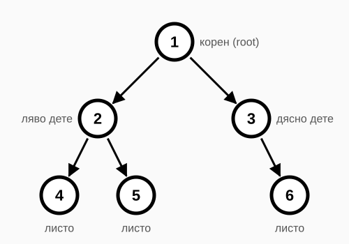
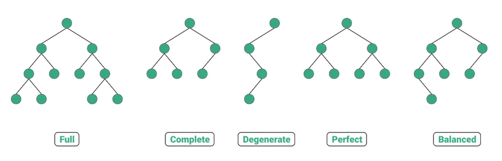
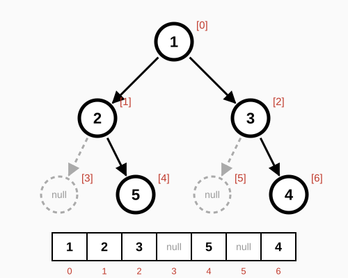
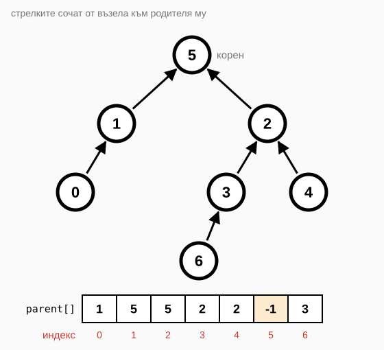
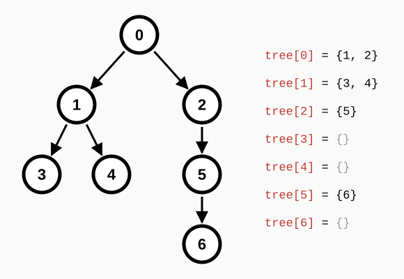
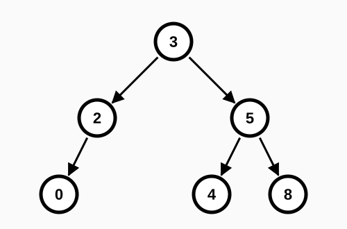
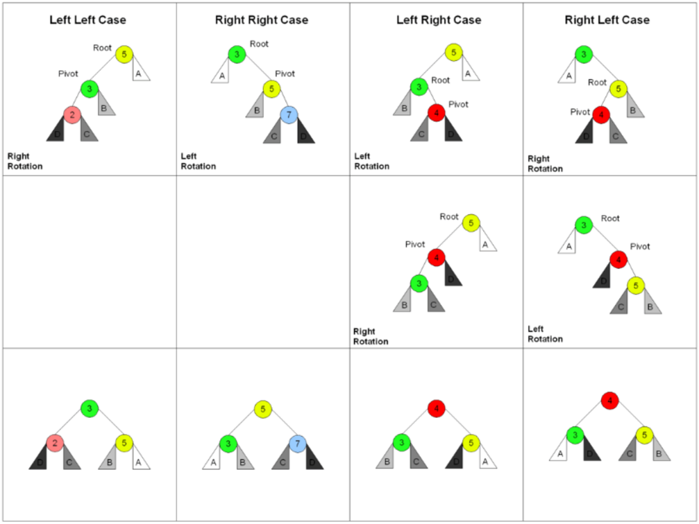
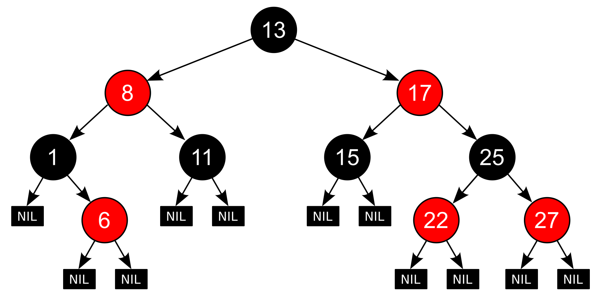

# Упражнение 6

## Темата включва

- [Tree (Дърво)](#tree-дърво)
- [Binary tree (Двоично дърво)](#binary-tree-двоично-дърво)
- [Представяне на дърво](#tree-representation-представяне-на-дърво)
- [Binary search tree (Двоично дърво за търсене)](#binary-search-tree-двоично-дърво-за-търсене)
- [Операции в BST](#bst-operations-операции-в-bst)
- [Обхождане на дърво](#tree-traversal-обхождане-на-дърво)
- [Балансирани дървета](#balanced-trees-балансирани-дървета)
- [Map и set](#ordered-map-and-set-наредени-map-и-set)
- [Задачи](#задачи)

## Tree (Дърво)

- Рекурсивна, нелинейна структура от данни, която се състои от възли (nodes), подобно на свързания списък. Всеки възел може да има няколко наследника (children), но най-много един предшественик (parent).
- Дървото няма цикли – то е *свързан ацикличен граф*.
- Коренът (root) на дървото е единственият възел без предшественик.

Допълнителни свойства и дефиниции:
- Ребро (edge) – връзка между родител и дете.
- Броят на възлите е с 1 по-голям от броя на ребрата: $|V| = |E| + 1$.
- Разклоненост – максималният брой наследници, които може да има възел в дървото.
- Път (path) – поредица от възли, в която всеки два съседни са свързани с ребро. Дължината на пътя е броят на ребрата в него, например пътят корен → дете → внук има дължина 2.
- Листо (leaf) – възел без наследници.
- Дълбочина на възел – дължината на пътя от корена до него (коренът е на дълбочина 0).
- Височина на дърво – максималната дълбочина на възел в него.

Още дефиниции може да намерите [тук](https://bg.wikipedia.org/wiki/%D0%94%D1%8A%D1%80%D0%B2%D0%BE_(%D0%BC%D0%B0%D1%82%D0%B5%D0%BC%D0%B0%D1%82%D0%B8%D0%BA%D0%B0)).

## Binary tree (Двоично дърво)

- Дърво, в което всеки възел има най-много два наследника – ляв и десен (left, right).

### Пример



### Видове двоични дървета



## Tree representation (Представяне на дърво)

### Чрез Node

Най-често използваното. Всеки възел съдържа данни и връзки към левия и десния наследник. Позволява динамично добавяне и премахване на елементи и е естествено за рекурсивни алгоритми.

#### Интерфейс на Node

<details>
  <summary>C++</summary>

```c++
template <typename T>
struct Node {
    T value;
    Node* left = nullptr;
    Node* right = nullptr;

    Node(const T& value, Node* left = nullptr, Node* right = nullptr)
        : value(value), left(left), right(right) { }
};
```

</details>

<details>
  <summary>Python</summary>

```python
class TreeNode:
    def __init__(self, val, left=None, right=None):
        self.val = val
        self.left = left
        self.right = right
```

</details>

### Чрез масив

Възелът на индекс `i` има ляво дете на индекс `2*i+1` и дясно – на `2*i+2`. Ако даден възел липсва, на неговия индекс в масива стои `null`.

Ниво $k$ заема индексите $[2^k - 1,\ 2^{k+1} - 2]$:
- Ниво 0 (корен): индекс 0
- Ниво 1: индекси [1, 2] (ляво и дясно дете на корена)
- Ниво 2: индекси [3, 6] (децата на ниво 1 – 4 на брой)
- Ниво 3: индекси [7, 14] (децата на ниво 2 – 8 на брой)

Пример: `[1, 2, 3, null, 5, null, 4]` (в Python `[1, 2, 3, None, 5, None, 4]`):



### Чрез parent array (масив от родители)

Масив, в който индексът е възелът, а стойността на този индекс е родителят му. Коренът има родител `-1`.

Пример: `parent[] = {1, 5, 5, 2, 2, -1, 3}` – родителят на 0 е 1, родителят на 1 е 5 и т.н.



### Чрез children list (списък от деца)

Всеки възел се представя чрез списък от децата си. Често се използва в задачи с произволни (не непременно двоични) дървета, където броят наследници варира.

**Формат:** `tree` е списък от `N` списъка, където:
- `tree[i]` съдържа индексите на децата на възел `i`;
- `N` е броят на възлите в дървото.

**Пример:**

<details>
  <summary>C++</summary>

```c++
vector<vector<int>> tree = {
    {1, 2},     // възел 0 има деца 1 и 2
    {3, 4},     // възел 1 има деца 3 и 4
    {5},        // възел 2 има дете 5
    {},         // възел 3 няма деца (листо)
    {},         // възел 4 няма деца (листо)
    {6},        // възел 5 има дете 6
    {}          // възел 6 няма деца (листо)
};
```

</details>

<details>
  <summary>Python</summary>

```python
tree = [
    [1, 2],     # възел 0 има деца 1 и 2
    [3, 4],     # възел 1 има деца 3 и 4
    [5],        # възел 2 има дете 5
    [],         # възел 3 няма деца (листо)
    [],         # възел 4 няма деца (листо)
    [6],        # възел 5 има дете 6
    []          # възел 6 няма деца (листо)
]
```

</details>

**Визуализация:**



**Типично използване:**

<details>
  <summary>C++</summary>

```c++
// Построяване на дърво от ребра
vector<vector<int>> buildTree(int n, const vector<vector<int>>& edges) {
    vector<vector<int>> tree(n);
    for (const auto& edge : edges) {
        int parent = edge[0];
        int child = edge[1];
        tree[parent].push_back(child);
    }
    return tree;
}

// DFS обхождане
void dfs(int node, const vector<vector<int>>& tree) {
    cout << node << " ";

    for (int child : tree[node]) {
        dfs(child, tree);
    }
}
```

</details>

<details>
  <summary>Python</summary>

```python
# Построяване на дърво от ребра
def build_tree(n, edges):
    tree = [[] for _ in range(n)]
    for parent, child in edges:
        tree[parent].append(child)
    return tree

# DFS обхождане
def dfs(node, tree):
    print(node, end=' ')

    for child in tree[node]:
        dfs(child, tree)
```

</details>

## Binary search tree (Двоично дърво за търсене)

Дефинира се рекурсивно:
1. Празното дърво (и всяко листо) е двоично дърво за търсене (BST).
2. Двоично дърво с корен `v` е BST, ако:
    - най-големият елемент в лявото поддърво на `v` е по-малък от стойността на `v`;
    - най-малкият елемент в дясното поддърво на `v` е по-голям от стойността на `v`;
    - лявото и дясното поддърво също са BST.

Примерно двоично дърво за търсене:



## BST operations (Операции в BST)
[BST интерактивно](https://www.cs.usfca.edu/~galles/visualization/BST.html).

### Интерфейс на BST

<details>
  <summary>C++</summary>

Пълна имплементация може да намерите в папка [Implementations](./Implementations/).

```c++
template <typename T>
class BinarySearchTree {
private:
    Node<T>* root = nullptr;

    bool _contains(const Node<T>* current, const T& value) const;
    Node<T>* _insert(Node<T>* current, const T& value);
    Node<T>* _remove(Node<T>* current, const T& value);
    void free(Node<T>* current);

public:
    BinarySearchTree() = default;
    BinarySearchTree(const BinarySearchTree<T>& other);
    BinarySearchTree<T>& operator=(const BinarySearchTree<T>& other);
    ~BinarySearchTree() { free(root); }

    bool contains(const T& value) const;
    void insert(const T& value);
    void remove(const T& value);

    void dfs() const;
    void bfs() const;
};
```

</details>

<details>
  <summary>Python</summary>

```python
class BinarySearchTree:
    def __init__(self):
        self.root = None

    def contains(self, value):
        pass

    def insert(self, value):
        pass

    def remove(self, value):
        pass

    def dfs(self):
        pass

    def bfs(self):
        pass
```

</details>

### Търсене

Търсенето използва свойството на BST – елементите вляво са по-малки, а вдясно – по-големи. Сравняваме търсената стойност с текущия възел и рекурсивно продължаваме в съответното поддърво.

**Рекурсивно:**

<details>
  <summary>C++</summary>

```c++
template <typename T>
bool BinarySearchTree<T>::contains(const T& value) const {
    return _contains(root, value);
}

template <typename T>
bool BinarySearchTree<T>::_contains(const Node<T>* current, const T& value) const {
    if (!current) {
        return false;
    }

    if (current->value == value) {
        return true;
    }

    return value < current->value ? _contains(current->left, value) : _contains(current->right, value);
}
```

</details>

<details>
  <summary>Python</summary>

```python
def _contains(self, current, value):
    if not current:
        return False
    if current.val == value:
        return True
    if value < current.val:
        return self._contains(current.left, value)
    return self._contains(current.right, value)

def contains(self, value):
    return self._contains(self.root, value)
```

</details>

**Итеративно:**

<details>
  <summary>C++</summary>

```c++
template <typename T>
bool BinarySearchTree<T>::contains(const T& value) const {
    const Node<T>* current = root;
    while (current && current->value != value) {
        current = value < current->value ? current->left : current->right;
    }

    return current != nullptr;
}
```

</details>

<details>
  <summary>Python</summary>

```python
def contains(self, value):
    current = self.root
    while current and current.val != value:
        current = current.left if value < current.val else current.right
    return current is not None
```

</details>

### Добавяне

Добавянето също използва свойството на BST. Сравняваме стойността с текущия възел и рекурсивно продължаваме в съответното поддърво, докато стигнем до празно място (липсващо дете), където създаваме новия възел. При връщането от рекурсията всяко извикване връща текущия възел, така че връзката между родител и дете се запазва.

**Рекурсивно:**

<details>
  <summary>C++</summary>

```c++
template <typename T>
void BinarySearchTree<T>::insert(const T& value) {
    root = _insert(root, value);
}

template <typename T>
Node<T>* BinarySearchTree<T>::_insert(Node<T>* current, const T& value) {
    if (!current) {
        return new Node<T>(value);
    }

    if (current->value < value) {
        current->right = _insert(current->right, value);
    }
    else if (value < current->value) {
        current->left = _insert(current->left, value);
    }

    return current;
}
```

</details>

<details>
  <summary>Python</summary>

```python
def _insert(self, current, value):
    if not current:
        return TreeNode(value)
    if value < current.val:
        current.left = self._insert(current.left, value)
    elif value > current.val:
        current.right = self._insert(current.right, value)
    return current

def insert(self, value):
    self.root = self._insert(self.root, value)
```

</details>

**Итеративно:**

<details>
  <summary>C++</summary>

```c++
template <typename T>
void BinarySearchTree<T>::insert(const T& value) {
    if (!root) {
        root = new Node<T>(value);
        return;
    }

    Node<T>* parent = nullptr;
    Node<T>* current = root;
    while (current && current->value != value) {
        parent = current;
        current = value < current->value ? current->left : current->right;
    }

    if (current) {
        return; // стойността вече е в дървото
    }

    if (value < parent->value) {
        parent->left = new Node<T>(value);
    }
    else {
        parent->right = new Node<T>(value);
    }
}
```

</details>

<details>
  <summary>Python</summary>

```python
def insert(self, value):
    if not self.root:
        self.root = TreeNode(value)
        return

    parent = None
    current = self.root
    while current and current.val != value:
        parent = current
        current = current.left if value < current.val else current.right

    if current:
        return  # стойността вече е в дървото

    if value < parent.val:
        parent.left = TreeNode(value)
    else:
        parent.right = TreeNode(value)
```

</details>

Кодът по-горе игнорира повторенията. Ако искаме да ги пазим:
- държим брояч (`count`) във всеки възел;
- или правим едната страна нестрога, т.е. в лявото поддърво на даден възел може да има и елементи, равни на него (`<=`).

### Триене

Има 3 случая:
- възел без деца – изтриваме го директно;
- възел с 1 дете – заместваме го с детето му;
- възел с 2 деца – заместваме стойността му с най-малката в дясното поддърво (или с най-голямата в лявото) и рекурсивно трием нея от съответното поддърво.

**Рекурсивно:**

<details>
  <summary>C++</summary>

```c++
template <typename T>
void BinarySearchTree<T>::remove(const T& value) {
    root = _remove(root, value);
}

template <typename T>
Node<T>* BinarySearchTree<T>::_remove(Node<T>* current, const T& value) {
    if (!current) {
        return nullptr;
    }

    if (value < current->value) {
        current->left = _remove(current->left, value);
    }
    else if (current->value < value) {
        current->right = _remove(current->right, value);
    }
    else {
        // 0 или 1 дете
        if (!current->left) {
            Node<T>* right = current->right;
            delete current;
            return right;
        }
        if (!current->right) {
            Node<T>* left = current->left;
            delete current;
            return left;
        }

        // 2 деца
        Node<T>* iter = current->right;
        while (iter->left) {
            iter = iter->left;
        }

        current->value = iter->value;
        current->right = _remove(current->right, current->value);
    }

    return current;
}
```

</details>

<details>
  <summary>Python</summary>

```python
def _remove(self, current, value):
    if not current:
        return None
    if value < current.val:
        current.left = self._remove(current.left, value)
    elif value > current.val:
        current.right = self._remove(current.right, value)
    else:
        # 0 или 1 дете
        if not current.left:
            return current.right
        if not current.right:
            return current.left

        # 2 деца
        temp = current.right
        while temp.left:
            temp = temp.left
        current.val = temp.val
        current.right = self._remove(current.right, temp.val)
    return current

def remove(self, value):
    self.root = self._remove(self.root, value)
```

</details>

Итеративна имплементация, която пренасочва връзките, вместо да копира стойности: пазим родителя на изтривания възел и пренасочваме неговото ляво или дясно дете – виж [решенията](./Solutions/Fundamental/TreeOperations/DeleteNodeInABst).


## Tree traversal (Обхождане на дърво)

Примерите са показани за следното BST, но важат за всяко двоично дърво:

```text
      3
     / \
    2   5
   /   / \
  0   4   8
```

### Depth-first search (Обхождане в дълбочина)

Алгоритъмът започва от корена и слиза възможно най-надълбоко по даден клон, преди да се върне назад.

#### Inorder traversal

- Извежда стойностите на BST в нарастващ ред.
- Схема: *Ляво – Корен – Дясно*

<details>
  <summary>C++</summary>

```c++
template <typename T>
void BinarySearchTree<T>::inorder(const Node<T>* current) const {
    if (!current) {
        return;
    }

    inorder(current->left);
    std::cout << current->value << " "; // 0 2 3 4 5 8
    inorder(current->right);
}
```

</details>

<details>
  <summary>Python</summary>

```python
def inorder(current):
    if current is None:
        return

    inorder(current.left)
    print(current.val, end=' ')  # 0 2 3 4 5 8
    inorder(current.right)
```

</details>

#### Preorder traversal

- Коренът е винаги първи.
- Схема: *Корен – Ляво – Дясно*

<details>
  <summary>C++</summary>

```c++
template <typename T>
void BinarySearchTree<T>::preorder(const Node<T>* current) const {
    if (!current) {
        return;
    }

    std::cout << current->value << " "; // 3 2 0 5 4 8
    preorder(current->left);
    preorder(current->right);
}
```

</details>

<details>
  <summary>Python</summary>

```python
def preorder(current):
    if current is None:
        return

    print(current.val, end=' ')  # 3 2 0 5 4 8
    preorder(current.left)
    preorder(current.right)
```

</details>

#### Postorder traversal

- Коренът е винаги последен.
- Схема: *Ляво – Дясно – Корен*

<details>
  <summary>C++</summary>

```c++
template <typename T>
void BinarySearchTree<T>::postorder(const Node<T>* current) const {
    if (!current) {
        return;
    }

    postorder(current->left);
    postorder(current->right);
    std::cout << current->value << " "; // 0 2 4 8 5 3
}
```

</details>

<details>
  <summary>Python</summary>

```python
def postorder(current):
    if current is None:
        return

    postorder(current.left)
    postorder(current.right)
    print(current.val, end=' ')  # 0 2 4 8 5 3
```

</details>

#### Iterative DFS

Обхождането в дълбочина може да се направи и без рекурсия, чрез стек (stack):

<details>
  <summary>C++</summary>

```c++
template <typename T>
void BinarySearchTree<T>::iterativeDfs() const { // inorder
    std::stack<Node<T>*> stack;
    Node<T>* current = root;

    while (current != nullptr || !stack.empty()) {
        while (current != nullptr) {
            stack.push(current);
            current = current->left;
        }

        current = stack.top();
        stack.pop();
        std::cout << current->value << " "; // 0 2 3 4 5 8
        current = current->right;
    }
}
```

</details>

<details>
  <summary>Python</summary>

```python
def iterative_inorder(root):
    stack = []
    current = root

    while stack or current:
        if current:
            stack.append(current)
            current = current.left
        else:
            current = stack.pop()
            print(current.val, end=' ')  # 0 2 3 4 5 8
            current = current.right
```

</details>

**Note:** В Python ограничението за дълбочина на рекурсията по подразбиране е 1000. Вместо да пишете итеративен вариант, може да го увеличите:

```python
import sys
sys.setrecursionlimit(10_000)
```

### Breadth-first search (Обхождане в широчина)

- Нарича се още *level order traversal* (обхождане по нива).
- Схема: *корен – дълбочина 1 – дълбочина 2 – ...*

<details>
  <summary>C++</summary>

```c++
template <typename T>
void BinarySearchTree<T>::bfs() const {
    if (!root) {
        return;
    }

    std::queue<Node<T>*> queue;
    queue.push(root);

    while (!queue.empty()) {
        size_t levelSize = queue.size();
        for (size_t i = 0; i < levelSize; i++) {
            Node<T>* current = queue.front();
            queue.pop();

            std::cout << current->value << " ";
            if (current->left) {
                queue.push(current->left);
            }
            if (current->right) {
                queue.push(current->right);
            }
        }
        std::cout << '\n';
    }
}
```

</details>

<details>
  <summary>Python</summary>

```python
from collections import deque

def bfs(root):
    if not root:
        return

    q = deque([root])
    level = 0

    while q:
        length = len(q)
        print(f"Level {level}:", end=' ')

        for _ in range(length):
            current = q.popleft()
            print(current.val, end=' ')

            if current.left:
                q.append(current.left)
            if current.right:
                q.append(current.right)

        print()
        level += 1

"""
Output:
Level 0: 3
Level 1: 2 5
Level 2: 0 4 8
"""
```

</details>

Разяснение на алгоритъма:
1. Обхожда първото ниво – корена – и добавя наследниците му в опашка (queue).
2. Преминава на следващото ниво – децата на корена. Текущият брой елементи в опашката е броят на тези деца.
3. Премахва първия елемент от опашката (първото дете) и добавя неговите наследници („внуците“ на корена) в края на опашката.
4. Повтаря *стъпка 3*, докато не премине през всички деца от *стъпка 2*.
5. След това в опашката са останали само възлите от следващото ниво – „внуците“ на корена.
6. Стъпките се повтарят, докато опашката не се изпразни.

## BST complexity (Сложност на операциите в BST)

| Операция  | Worst case         | Average case          |
| --------- | ------------------ | --------------------- |
| търсене   | $\mathcal{O}(n)$   | $\Theta(\log n)$      |
| добавяне  | $\mathcal{O}(n)$   | $\Theta(\log n)$      |
| триене    | $\mathcal{O}(n)$   | $\Theta(\log n)$      |
| обхождане | $\mathcal{O}(n)$   | $\Theta(n)$           |

Тук $n$ е броят на възлите. Търсенето, добавянето и триенето са $\mathcal{O}(h)$, където $h$ е височината на дървото, т.е. сложността зависи от балансираността му. При добавяне на сортирани числа (1, 2, 3, …) дървото се изражда в свързан списък и $h = n$.

### Имплементации в стандартните библиотеки

<details>
  <summary>C++</summary>

В STL няма небалансирано двоично дърво за търсене – ако ни трябва такова, трябва да си го напишем сами. Имплементация може да намерите в папка [Implementations](./Implementations/).

</details>

<details>
  <summary>Python</summary>

В Python няма вградено двоично дърво за търсене – ако ни трябва такова, трябва да си го напишем сами. Примерна имплементация има в [playground-а](./playground_06.ipynb) и в [TheAlgorithms Python](https://github.com/TheAlgorithms/Python/tree/master/data_structures/binary_tree).

</details>

## Balanced trees (Балансирани дървета)

### AVL tree (AVL дърво)

- Самобалансиращо се двоично дърво за търсене.
- За всеки възел разликата във височините на лявото и дясното поддърво е най-много 1.
- Гарантира сложност $\mathcal{O}(\log n)$ в най-лошия случай при търсене, добавяне и триене на елемент.
- Балансиране е нужно, когато при добавяне или триене на елемент се наруши горното свойство.

#### Визуализация на операциите по балансиране
Интерактивно: [AVL визуализация](https://www.cs.usfca.edu/~galles/visualization/AVLtree.html).


### Различните случаи на дисбаланс и как се коригират чрез ротации:


### Balance Factor (Баланс фактор)

- За всеки възел: `BF = height(right) - height(left)`
- Балансиран възел: `-1 <= BF <= 1`
- Дисбаланс: `|BF| > 1`

Възелът в AVL дърво пази и височината на поддървото си:

<details>
  <summary>C++</summary>

```c++
struct Node {
    int key;
    int height = 1; // листото има височина 1, а nullptr - 0
    Node* left = nullptr;
    Node* right = nullptr;

    Node(int key) : key(key) {}
};

int height(Node* node) {
    return node ? node->height : 0;
}

int getBalance(Node* node) {
    return node ? height(node->right) - height(node->left) : 0;
}
```

</details>

<details>
  <summary>Python</summary>

```python
class Node:
    def __init__(self, key):
        self.key = key
        self.height = 1  # листото има височина 1, а None - 0
        self.left = None
        self.right = None


def height(node):
    return node.height if node else 0


def get_balance(node):
    return height(node.right) - height(node.left) if node else 0
```

</details>

### 4-те случая на дисбаланс

**Забележка:** В примерите използваме конкретни стойности (31, 99, 133, които в кода отговарят на x, y, z) и обозначаваме поддърветата с T1, T2, T3, T4, за да покажем как се преместват при ротация.

#### 1. Left-Left (LL) – единична дясна ротация

**Кога възниква:** добавяме в **лявото** поддърво на **лявото** дете.

```text
           133 (BF = -2)                 99
          /   \                        /    \
  (-1)  99     T4         =>         31      133
       /  \                         /  \    /   \
     31    T2                      T1  T3  T2    T4
    /  \
  T1    T3   <- новият елемент е в T1 или T3
```

**Решение:** right rotation около 133.

Поддървото **T2** се премества от дясно дете на 99 в ляво дете на 133.

<details>
  <summary>C++</summary>

```c++
Node* rightRotate(Node* z) {  // z = 133
    Node* y = z->left;        // y = 99
    Node* T2 = y->right;      // T2

    y->right = z;
    z->left = T2;

    // Update heights
    z->height = 1 + max(height(z->left), height(z->right));
    y->height = 1 + max(height(y->left), height(y->right));

    return y; // new root (99)
}
```

</details>

<details>
  <summary>Python</summary>

```python
def right_rotate(z):  # z = 133
    y = z.left        # y = 99
    T2 = y.right      # T2

    y.right = z
    z.left = T2

    # Update heights
    z.height = 1 + max(height(z.left), height(z.right))
    y.height = 1 + max(height(y.left), height(y.right))

    return y  # new root (99)
```

</details>

---

#### 2. Right-Right (RR) – единична лява ротация

**Кога възниква:** добавяме в **дясното** поддърво на **дясното** дете.

```text
      31 (BF = 2)                   99
     /  \                          /  \
    T1   99 (BF = 1)      =>      31   133
        /  \                     / \   / \
       T2  133                  T1 T2 T3 T4
          / \
         T3  T4  <- новият елемент е в T3 или T4
```

**Решение:** left rotation около 31.

Поддървото **T2** се премества от ляво дете на 99 в дясно дете на 31.

<details>
  <summary>C++</summary>

```c++
Node* leftRotate(Node* x) {  // x = 31
    Node* y = x->right;      // y = 99
    Node* T2 = y->left;      // T2

    y->left = x;
    x->right = T2;

    // Update heights
    x->height = 1 + max(height(x->left), height(x->right));
    y->height = 1 + max(height(y->left), height(y->right));

    return y; // new root (99)
}
```

</details>

<details>
  <summary>Python</summary>

```python
def left_rotate(x):  # x = 31
    y = x.right       # y = 99
    T2 = y.left       # T2

    y.left = x
    x.right = T2

    # Update heights
    x.height = 1 + max(height(x.left), height(x.right))
    y.height = 1 + max(height(y.left), height(y.right))

    return y  # new root (99)
```

</details>

---

#### 3. Left-Right (LR) – двойна ротация (ляво-дясна)

**Кога възниква:** добавяме в **дясното** поддърво на **лявото** дете.

```text
        133 (BF = -2)          133                  99
       /   \                  /   \                /  \
 (1) 31     T4      =>      99     T4     =>     31    133
    /  \                   /  \                 / \    / \
  T1    99               31    T3              T1 T2  T3  T4
       /  \             /  \
     T2    T3         T1    T2
     ^- новият елемент е в T2 или T3
```

**Решение:**

1. Left rotation около 31 (x) – поддървото **T2** става дясно дете на 31.
2. Right rotation около 133 (z) – поддървото **T3** става ляво дете на 133.

**Защо две ротации, а не просто right rotation около 133?**

Ако направим само right rotation около 133, отново ще имаме същия дисбаланс, но от другата страна:

```text
        133                  31
       /   \                /  \
     31     T4     =>     T1    133
    /  \                       /   \
  T1    99                   99     T4
       /  \                 /  \
     T2    T3             T2    T3
```

<details>
  <summary>C++</summary>

```c++
Node* leftRightRotate(Node* z) {    // z = 133
    z->left = leftRotate(z->left);  // leftRotate(31)
    return rightRotate(z);          // rightRotate(133) -> връща 99
}
```

</details>

<details>
  <summary>Python</summary>

```python
def left_right_rotate(z):          # z = 133
    z.left = left_rotate(z.left)   # left_rotate(31)
    return right_rotate(z)         # right_rotate(133) -> връща 99
```

</details>

---

#### 4. Right-Left (RL) – двойна ротация (дясно-лява)

**Кога възниква:** добавяме в **лявото** поддърво на **дясното** дете.

```text
   31 (BF = 2)              31                     99
  /  \                     /  \                   /  \
 T1   133 (-1)    =>     T1    99        =>     31    133
     /   \                    /  \             / \    / \
   99     T4                T2    133         T1 T2  T3  T4
  /  \                           /   \
T2    T3                       T3     T4
^- новият елемент е в T2 или T3
```

**Решение:**

1. Right rotation около 133 (z) – поддървото **T3** става ляво дете на 133.
2. Left rotation около 31 (x) – поддървото **T2** става дясно дете на 31.

<details>
  <summary>C++</summary>

```c++
Node* rightLeftRotate(Node* x) {       // x = 31
    x->right = rightRotate(x->right);  // rightRotate(133)
    return leftRotate(x);              // leftRotate(31) -> връща 99
}
```

</details>

<details>
  <summary>Python</summary>

```python
def right_left_rotate(x):            # x = 31
    x.right = right_rotate(x.right)  # right_rotate(133)
    return left_rotate(x)            # left_rotate(31) -> връща 99
```

</details>

---

### Алгоритъм за балансиране при insert

<details>
  <summary>C++</summary>

```c++
Node* insert(Node* node, int key) {
    // 1. Perform the normal BST insertion
    if (node == nullptr)
        return new Node(key);

    if (key < node->key)
        node->left = insert(node->left, key);
    else if (key > node->key)
        node->right = insert(node->right, key);
    else // Equal keys are not allowed in BST
        return node;

    // 2. Update height of this ancestor node
    node->height = 1 + max(height(node->left), height(node->right));

    // 3. Get the balance factor of this ancestor node
    int balance = getBalance(node);

    // 4. If this node becomes unbalanced, then there are 4 cases

    // Left Left Case
    if (balance < -1 && key < node->left->key)
        return rightRotate(node);

    // Right Right Case
    if (balance > 1 && key > node->right->key)
        return leftRotate(node);

    // Left Right Case
    if (balance < -1 && key > node->left->key) {
        node->left = leftRotate(node->left);
        return rightRotate(node);
    }

    // Right Left Case
    if (balance > 1 && key < node->right->key) {
        node->right = rightRotate(node->right);
        return leftRotate(node);
    }

    // Return the (unchanged) node pointer
    return node;
}
```

</details>

<details>
  <summary>Python</summary>

```python
def insert(node, key):
    # 1. Perform the normal BST insertion
    if not node:
        return Node(key)

    if key < node.key:
        node.left = insert(node.left, key)
    elif key > node.key:
        node.right = insert(node.right, key)
    else:
        return node  # Equal keys not allowed

    # 2. Update height
    node.height = 1 + max(height(node.left), height(node.right))

    # 3. Get balance factor
    balance = get_balance(node)

    # 4. Balance cases
    # Left Left Case
    if balance < -1 and key < node.left.key:
        return right_rotate(node)

    # Right Right Case
    if balance > 1 and key > node.right.key:
        return left_rotate(node)

    # Left Right Case
    if balance < -1 and key > node.left.key:
        node.left = left_rotate(node.left)
        return right_rotate(node)

    # Right Left Case
    if balance > 1 and key < node.right.key:
        node.right = right_rotate(node.right)
        return left_rotate(node)

    return node
```

</details>

### Запомняне по картинка

```text
    LL (Left-Left):        LR (Left-Right):
         z                      z
        /                      /
       y                      y
      /                        \
     x                          x

    Форма: /               Форма: <


    RR (Right-Right):      RL (Right-Left):
    z                      z
     \                      \
      y                      y
       \                    /
        x                  x

    Форма: \               Форма: >
```

Правило:
- Права линия (LL, RR) → 1 ротация
- Начупена линия (LR, RL) → 2 ротации (първо изправяме, после завъртаме)

### Сравнение на структурите по сложност по време

| Операция | Масив                       | Свързан списък   | Сортиран масив        | BST              | Балансирано BST       |
| -------- | --------------------------- | ---------------- | --------------------- | ---------------- | --------------------- |
| търсене  | $\mathcal{O}(n)$            | $\mathcal{O}(n)$ | $\mathcal{O}(\log n)$ | $\mathcal{O}(n)$ | $\mathcal{O}(\log n)$ |
| добавяне | Amortized $\mathcal{O}(1)$  | $\mathcal{O}(1)$ | $\mathcal{O}(n)$      | $\mathcal{O}(n)$ | $\mathcal{O}(\log n)$ |
| триене   | $\mathcal{O}(n)$            | $\mathcal{O}(n)$ | $\mathcal{O}(n)$      | $\mathcal{O}(n)$ | $\mathcal{O}(\log n)$ |

В масив и свързан списък добавяме в края/началото. Триенето по стойност включва и търсенето на елемента.


## Ordered map and set (Наредени map и set)

Наредените (ordered) map и set подреждат елементите/ключовете по големина. Обикновено са имплементирани чрез балансирано двоично дърво за търсене, затова добавянето, търсенето и триенето са $\mathcal{O}(\log n)$, а обхождането им е *inorder*, т.е. в нарастващ ред.

<details>
  <summary>C++</summary>

В C++ има *наредени* (ordered) колекции: *[set](https://en.cppreference.com/w/cpp/container/set.html)*, *[map](https://en.cppreference.com/w/cpp/container/map.html)*, *[multiset](https://en.cppreference.com/w/cpp/container/multiset.html)* и *[multimap](https://en.cppreference.com/w/cpp/container/multimap.html)*. На практика (GCC, Clang, MSVC) са имплементирани чрез червено-черни дървета (red-black tree).

#### Map
- Двойки ключ – стойност (key – value).
- Ключовете са уникални.
- Дървото е сортирано по ключ.
- Операции: `insert()`, `erase()`, `find()`, `[]` – всички $\mathcal{O}(\log n)$. `m[key]` създава елемента, ако го няма.
- Пример:
  ```c++
  std::map<int, std::string> m;
  // Map с компаратор за низходящ ред по ключ (може и собствен компаратор):
  // std::map<int, std::string, std::greater<int>> mDesc;

  m[1] = "one";
  m.insert({2, "two"});
  m[3] = "three";

  // Търсене
  if (m.find(1) != m.end()) { /* намерен */ }

  // lower bound и upper bound
  auto lb = m.lower_bound(2); // първият елемент с key >= 2
  auto ub = m.upper_bound(2); // първият елемент с key > 2

  // Премахване
  m.erase(2);  // по ключ
  auto it = m.find(3);
  if (it != m.end()) {
      m.erase(it);  // по итератор
  }

  // Итериране (в сортиран ред по ключ)
  for (const auto& [key, value] : m) {
      std::cout << key << ": " << value << "\n";
  }
  ```

#### Set
- Множество от уникални елементи.
- Дървото е сортирано по елементите.
- Операции: `insert()`, `erase()`, `find()`, `count()` – всички $\mathcal{O}(\log n)$.
- Пример:
  ```c++
  std::set<int> s;
  // Set с компаратор за низходящ ред (може и собствен компаратор):
  // std::set<int, std::greater<int>> sDesc;

  s.insert(5);
  s.insert(3);
  s.insert(8);

  // lower bound и upper bound
  auto lb = s.lower_bound(5); // първият елемент >= 5
  auto ub = s.upper_bound(5); // първият елемент > 5

  // Търсене
  if (s.count(5)) { /* съществува */ }

  // Премахване
  s.erase(3);  // по стойност
  auto it = s.find(8);
  if (it != s.end()) {
      s.erase(it);  // по итератор
  }

  // Итериране (в сортиран ред)
  for (int val : s) {
      std::cout << val << " ";
  }
  ```

</details>

<details>
  <summary>Python</summary>

Няма вградено балансирано двоично дърво за търсене в Python.
Структурите *set* и *dict* използват *Hash table*. Може да разгледате външната библиотека [Python Sorted Containers](https://grantjenks.com/docs/sortedcontainers/), която обаче не използва BST.

Примерна имплементация [AVL Tree in Python](https://github.com/TheAlgorithms/Python/blob/master/data_structures/binary_tree/avl_tree.py) и [Red-Black Tree in Python](https://github.com/TheAlgorithms/Python/blob/master/data_structures/binary_tree/red_black_tree.py).

</details>

# Задачи

## За упражнение на основните техники
- [Search in a Binary Search Tree](https://leetcode.com/problems/search-in-a-binary-search-tree/)
  - рекурсивно и итеративно
- [Insert into a BST](https://leetcode.com/problems/insert-into-a-binary-search-tree/)
  - рекурсивно и итеративно
- [Delete Node in a BST](https://leetcode.com/problems/delete-node-in-a-bst/)
- Traversals (първите 3 "невидимо" ползват стек)
  - [inorder](https://leetcode.com/problems/binary-tree-inorder-traversal/)
  - [postorder](https://leetcode.com/problems/binary-tree-postorder-traversal/)
  - [preorder](https://leetcode.com/problems/binary-tree-preorder-traversal/)
  - [level order](https://leetcode.com/problems/binary-tree-level-order-traversal/)
- [Validate BST](https://leetcode.com/problems/validate-binary-search-tree/) - Medium
  - с допълнителна памет
  - без допълнителна памет
- [Binary Tree Right side view](https://leetcode.com/problems/binary-tree-right-side-view/)
	- bfs
 	- dfs
- [Maximum depth of binary tree](https://leetcode.com/problems/maximum-depth-of-binary-tree/)

## Още задачи за дървета

### Easy
- [Same Tree](https://leetcode.com/problems/same-tree/)
- [Symmetric Tree](https://leetcode.com/problems/symmetric-tree/)
- [Range Sum of BST](https://leetcode.com/problems/range-sum-of-bst/)
- [Diameter of a binary tree](https://leetcode.com/problems/diameter-of-binary-tree/)

### Medium
- [Convert BST to Greater Tree](https://leetcode.com/problems/convert-bst-to-greater-tree/)
- [Lowest Common Ancestor of Deepest Leaves](https://leetcode.com/problems/lowest-common-ancestor-of-deepest-leaves/)
- Имаме дърво с уникални числа на всеки Node. Като вход ще получим много заявки за проверка дали един Node е наследник на друг. Заявките са от вида 1 наследник ли е на 3.
	- бавно решение - всеки път проверка
    - entry и exit time

<details>
  <summary>Explanation</summary>

```text
      1
     / \
    2   3
   /   / \
  4   5   6

// entry и exit time на всеки възел при DFS обхождане
        1 (1, 12)
       /         \
  2 (2, 5)      3 (6, 11)
     /          /       \
 4 (3, 4)   5 (7, 8)   6 (9, 10)

// x е наследник на y, ако entry[y] < entry[x] && exit[x] < exit[y]
```

</details>

## Задачи за map и set
- [Volleyball friends](https://www.hackerrank.com/contests/sda-hw-8/challenges/volleyball-friends)
- [Smallest Number in Infinite Set](https://leetcode.com/problems/smallest-number-in-infinite-set/)
- [Continuous Subarrays](https://leetcode.com/problems/continuous-subarrays/)

# Бонус

## Бонус задачи
- [Binary Search Tree Iterator](https://leetcode.com/problems/binary-search-tree-iterator/) - Medium
  - итератор на дърво
  - **Hint:** stack
  - [Implement BST iterator (GeeksforGeeks)](https://www.geeksforgeeks.org/implement-binary-search-treebst-iterator/)

## Бонус теория

### B-tree (B-дърво)
- Използвани в базите от данни
- [Обяснение на B-tree (видео)](https://www.youtube.com/watch?v=K1a2Bk8NrYQ)

### Red-black tree (Червено-черно дърво)

- Също гарантира сложност $\mathcal{O}(\log n)$ в най-лошия случай при търсене, добавяне и триене на елемент.
- Добавянето и триенето изискват по-рядко балансиране, тъй като балансът се поддържа по-малко строго, отколкото при AVL дървото.
- [Wikipedia](https://en.wikipedia.org/wiki/Red%E2%80%93black_tree)

Свойства:
- Всеки възел е червен или черен.
- Коренът е винаги черен.
- Всяко листо (NIL leaf) е черно.
- Децата на червен възел са винаги черни.
- Всеки път от даден възел до NIL листо в поддървото му минава през равен брой черни възли.

Следствия:
- Родителят на червен възел е винаги черен.
- Възел с точно едно (не-NIL) дете е винаги черен, а детето му е червено.




