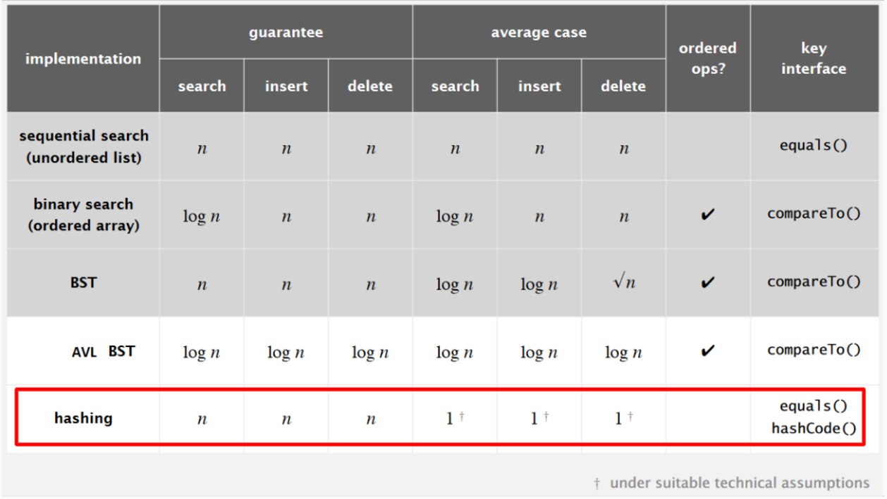

# Упражнение 7

## Темата включва

- [Хеш функции](#hash-function-хеш-функция)
- [Хеш таблица](#hash-table-хеш-таблица)
- [Справяне с колизии](#collision-resolution-справяне-с-колизии)
- [Unordered map и set](#unordered-map-and-set-ненаредени-map-и-set)
- [Мултимножества](#мултимножества)
- [Какво е нужно на структура, за да бъде ключ в хеш таблица?](#какво-е-нужно-на-структура-за-да-бъде-ключ-в-хеш-таблица)
- [Сравнение на сложностите](#сравнение-на-сложностите-и-необходими-функции)
- [Rolling hash](#техника-rolling-hash)
- [Задачи](#задачи)

## Hash function (Хеш функция)
Хеш функция наричаме функция, която получава елемент от произволно голямо множество (дори безкрайно) и връща стойност от някакво фиксирано крайно множество.

Основните характеристики на хеш функциите са:

- Да бъдат бързи за изчисление.
- Да създават минимален брой колизии – т.е. данните да са разпределени равномерно в целия интервал.
- Когато хешират един и същи обект, винаги да връщат една и съща стойност – да няма елемент на случайност или някакво състояние, което да повлияе на резултата от функцията (*stateless*).
- От $x == y$ следва $hash(x) == hash(y)$.
- От $hash(x) == hash(y)$ **не следва задължително** $x == y$.

### Пример

**Наивна хеш функция за низове**:
```text
Низ "abd":
'a' → 1, 'b' → 2, 'd' → 4
hash("abd") = 1 + 2 + 4 = 7

Низ "bad":
'b' → 2, 'a' → 1, 'd' → 4
hash("bad") = 2 + 1 + 4 = 7  ← КОЛИЗИЯ!
```

Две различни думи имат еднаква хеш стойност → **колизия**.

**По-добра хеш функция**:
```text
hash(s) = s[0]·p^(n-1) + s[1]·p^(n-2) + ... + s[n-2]·p¹ + s[n-1]·p⁰

Където p е просто число (например 31), n е дължината на низа

"abd" (n=3) → 1·31² + 2·31¹ + 4·31⁰ = 961 + 62 + 4 = 1027
"bad" (n=3) → 2·31² + 1·31¹ + 4·31⁰ = 1922 + 31 + 4 = 1957

Различни стойности! ✓
```

## Hash table (Хеш таблица)

[**Визуализация във VisuAlgo**](https://visualgo.net/en/hashtable)

**Дефиниция:** Структура от данни, която съхранява двойки ключ-стойност и осигурява бърз достъп (средно $`\mathcal{O}(1)`$) чрез хеширане.

**Основна идея:** Използва масив и хеш функция за директен достъп до елементите. Вместо да търсим линейно или двоично, изчисляваме **къде точно** е елементът.

**Как работи:**
```text
Ключ → хешираме ключа → получаваме индекс в масив → записваме стойността

"John" → hash("John") → 42 → "john@example.com"
```

**Предимства:**
- Константно време за търсене/добавяне/триене (average case)
- Ефективна за голям брой операции

**Недостатъци:**
- Не запазва подреденост – не можем бързо да вземем минимума или следващия по големина ключ, или последователност на добавяне
- Заема повече памет (поради load factor)
- Възможни колизии

Още много за хеш таблицата можете да прочетете [тук](https://en.wikipedia.org/wiki/Hash_table).

---

### Load factor (Коефициент на запълване)

**Load factor (α)** показва колко запълнена е хеш таблицата:

```text
α = n / m

където:
n = брой елементи в таблицата
m = размер на масива
```

Например 6 елемента в масив с 8 клетки дават $\alpha = 6 / 8 = 0.75$.

**Защо е важен:**
- Колкото по-малък е α, толкова по-малко колизии, но неефективно използване на памет
- Колкото по-голям е α, толкова повече колизии и по-бавно време за операции

**Използва се различен load factor в зависимост от метода за справяне с колизии.**

Когато α надмине определен праг, масивът се увеличава (обикновено двойно) и всички елементи се хешират наново (rehashing). Тази операция е $\mathcal{O}(n)$, но се случва рядко, затова добавянето е amortized $\mathcal{O}(1)$ – както при динамичния масив.

<details>
  <summary>C++</summary>

`std::unordered_map` използва separate chaining и по подразбиране разширява при $\alpha > 1$ (`max_load_factor()`).

</details>

<details>
  <summary>Python</summary>

`dict` използва open addressing и разширява, когато се запълни $\frac{2}{3}$ от таблицата.

</details>

---

## Collision resolution (Справяне с колизии)

Хеш функцията преобразува ключа в индекс на масива. Тъй като размерът на масива е ограничен, а възможните ключове са безкрайни, е възможно два различни ключа да се хешират до един и същи индекс – това се нарича **колизия**. Колизиите са неизбежна част от хеширането. Затова е важно хеш функцията да разпределя ключовете възможно най-равномерно, понеже справянето с колизиите увеличава средното време за изпълнение на заявка.

### Separate chaining (Отделни вериги)
- Това е най-популярният метод за справяне с колизии.
- Когато обект, представен като цяло число, принадлежи на заета клетка (същото цяло число), двата обекта се нареждат в свързан списък.
- Проверката дали елемент принадлежи на списъка се извършва линейно – средно списъкът има α елемента.
- Използва се свързан списък, защото бързо се добавя елемент в края и се премахва елемент от средата.

```text
Хеш таблица (m=7):

0: → ["cat", 5] → ["dog", 3] → null
1: → null
2: → ["apple", 10] → null
3: → ["car", 7] → ["bus", 2] → ["bike", 9] → null
4: → null
5: → ["sun", 1] → null
6: → ["moon", 4] → null

hash("cat") = hash("dog") = 0  ← колизия, но двата са в списък
```

### Open addressing (Отворено адресиране)
[Open addressing](https://en.wikipedia.org/wiki/Open_addressing) е друг метод за справяне с колизии, при който всеки запис се съхранява директно в масива, а колизиите се решават чрез пробване (probing). Затова винаги $\alpha < 1$.

При триене клетката не може просто да се изпразни, защото търсенето на елемент спира при първата празна клетка и ще пропусне елементите след нея. Вместо това клетката се маркира като изтрита (tombstone).

#### Linear probing (Линейно пробване)
- Формула: $index = (h(key) + i) \bmod m$, където $i = 0, 1, 2, ...$
- Ако обект се хешира до дадено цяло число *x*, но то вече е заето, тогава ще бъде попълнено първото свободно число, по-голямо от *x*.
- Ако например обект се хешира до числото 5 и то е заето, тогава се започва търсене в 6, 7 и т.н.
- Не толкова предпочитан метод поради наличието на *clustering*.
- [Описание на операциите по търсене, добавяне, триене](https://en.wikipedia.org/wiki/Linear_probing#Operations)

Пример за триене на средния от три елемента:

```text
A, B и C се хешират до 5 и заемат 5, 6, 7:
    5  6  7
[ ][A][B][C][ ]

Триене на B с изпразване – търсенето на C спира в 6:
    5  6  7
[ ][A][ ][C][ ]   → C не е намерен ✗

Решение с Tombstone – търсенето минава през &, добавянето може да преизползва &:
    5  6  7
[ ][A][&][C][ ]   → C е намерен ✓

Решение с Backward shift – C се премества на освободеното място:
    5  6  7
[ ][A][C][ ][ ]   → C е намерен ✓
```

**Clustering** в хеш таблица – явление, при което множество хеш стойности попадат в близки позиции, създавайки групи, които влошават ефективността на таблицата.
Пример: ако се замислите, в автобус 94 винаги има най-много хора около вратите на автобуса, докато в средата е по-празно. Тогава казваме, че има клъстер при всяка от вратите.

```text
Преди:
0: [ ][ ][ ][A][B][ ][ ][ ][ ][ ]
              ↑
           клъстър

След добавяне на C, D, E:
0: [ ][ ][ ][A][B][C][D][E][ ][ ]
              ↑____________↑
           голям клъстър!

→ Всички нови елементи с hash ∈ {3,4,5,6,7} ще удължат клъстъра
→ Операциите стават O(n) в най-лош случай
```

#### Double hashing (Двойно хеширане)
- Използва 2 хеширащи функции, през които да прекарва даден обект.
- Първата функция $h1(key)$ дава началната позиция.
- При колизия втората функция $h2(key)$ определя стъпката за търсене.
- Формула: $index = (h1(key) + i \cdot h2(key)) \bmod m$, където $i = 0, 1, 2, ...$
- [Ресурс за double hashing](https://en.wikipedia.org/wiki/Double_hashing)

#### Quadratic probing (Квадратично пробване)
- [Wikipedia](https://en.wikipedia.org/wiki/Quadratic_probing)

## Unordered map and set (Ненаредени map и set)

Основните структури, които са имплементирани чрез хеш таблица, са *set* и *map*.

#### Set

Представлява множество, в което всеки елемент е хеширан. За амортизирано константно време – $\mathcal{O}(1)$, може да извършва операциите:
1) Да провери дали съществува даден елемент в множеството.
2) Да добави елемент в множеството.
3) Да премахне елемент от множеството.
4) Да вземе броя на елементите в множеството.

#### Map

Аналогична на *set*-а, но се състои от ключове, които сочат към стойности.
- Ключовете биват хеширани – отговарят на горепосочените характеристики на *set*-а.
- Не предоставя възможност за константна проверка дали дадена стойност съществува – единствено ключ. Търсенето по стойност е $\mathcal{O}(n)$.

<details>
  <summary>C++</summary>

В C++ това са *[unordered_set](https://en.cppreference.com/w/cpp/container/unordered_set)* и *[unordered_map](https://en.cppreference.com/w/cpp/container/unordered_map)*.

</details>

<details>
  <summary>Python</summary>

В Python това са *set* и *dict*.

Разписано как работи *dict*-а в Python: [ресурс](https://stackoverflow.com/questions/327311/how-are-pythons-built-in-dictionaries-implemented).

</details>

## Мултимножества
В курса няма конкретно да разглеждаме следните структури, но е хубаво да знаете за съществуването им, понеже могат да бъдат полезни в някои задачи. Накратко, multimap структурите допускат повторения на ключовете, а multiset – на стойностите.

<details>
  <summary>C++</summary>

Повече може да прочетете на съответните линкове:
- [std::multimap](https://en.cppreference.com/w/cpp/container/multimap)
- [std::multiset](https://en.cppreference.com/w/cpp/container/multiset)
- [std::unordered_multimap](https://en.cppreference.com/w/cpp/container/unordered_multimap)
- [std::unordered_multiset](https://en.cppreference.com/w/cpp/container/unordered_multiset)

</details>

## Какво е нужно на структура, за да бъде ключ в хеш таблица?
- Трябва да има дефинирана хеш функция, която връща цяло число.
- Трябва да има дефинирана функция/оператор за равенство (==), за да се проверява дали два ключа са еднакви.
- Във всеки език тези функции са дефинирани по подразбиране за основните типове (int, string и т.н.), но за потребителски типове трябва да ги дефинираме сами.

<details>
  <summary>C++</summary>

Пример в папка [Examples](./Examples/).

</details>

## Сравнение на сложностите и необходими функции



## Техника Rolling hash

Техника за ефективно изчисляване на хеш стойност при преместване на "прозорец" върху низ или масив. Вместо да пресмятаме хеша отначало за всеки прозорец, актуализираме стойността, получена за предишния прозорец, за $\mathcal{O}(1)$ време.

**Note:** Не е постижимо с всяка хеш функция!

```text
Пример:
Низ: "abcde"
Хеш функция: hash(s) = s[0]·p^(n-1) + s[1]·p^(n-2) + ... + s[n-2]·p¹ + s[n-1]·p⁰
Нека p = 31.
Нека 'a' = 1, 'b' = 2, 'c' = 3, 'd' = 4, 'e' = 5 ...
Нека прозорецът е с дължина 3.

Следователно:
hash("abc") = 1·31² + 2·31¹ + 3·31⁰ = 961 + 62 + 3 = 1026
hash("bcd") = 2·31² + 3·31¹ + 4·31⁰ = 1922 + 93 + 4 = 2019

Но hash("bcd") може да се изчисли от hash("abc"):
hash("bcd") = (hash("abc") - 1·31²) · 31 + 4·31⁰ = (1026 - 961) · 31 + 4 = 2019
```

Общо, за прозорец с дължина $k$:

$$hash_{i+1} = (hash_i - s_i \cdot p^{k-1}) \cdot p + s_{i+k}$$

Така хешът на всеки следващ прозорец се смята за $\mathcal{O}(1)$ вместо за $\mathcal{O}(k)$.

Задача, която можем да решим с тази техника:
- [Repeated DNA Sequences](https://leetcode.com/problems/repeated-dna-sequences/), виж [решенията](./Solutions/Medium/RepeatedDnaSequences)

Полезни ресурси:
- [Rolling hash](https://en.wikipedia.org/wiki/Rolling_hash)
- [Rabin-Karp string search algorithm](https://en.wikipedia.org/wiki/Rabin%E2%80%93Karp_algorithm)
- [Нагледно с код](https://www.francofernando.com/blog/algorithms/2021-05-16-rolling-hash/)

## Задачи

### Easy
- [Two Sum](https://leetcode.com/problems/two-sum/)
- [Isomorphic Strings](https://leetcode.com/problems/isomorphic-strings/)
- [Contains Duplicate II](https://leetcode.com/problems/contains-duplicate-ii/)

### Medium
- [Longest Consecutive Sequence](https://leetcode.com/problems/longest-consecutive-sequence/)
  - сортиран масив/set срещу hash set
- [Longest Substring Without Repeating Characters](https://leetcode.com/problems/longest-substring-without-repeating-characters/)
  - добра за live coding
- [Group Anagrams](https://leetcode.com/problems/group-anagrams/)
- [Special Triples](https://www.hackerrank.com/contests/sda-hw-9-2022/challenges/challenge-3771/)
- [Count Number of Bad Pairs](https://leetcode.com/problems/count-number-of-bad-pairs/)
- [K-diff Pairs in an Array](https://leetcode.com/problems/k-diff-pairs-in-an-array/)
- [Repeated DNA Sequences](https://leetcode.com/problems/repeated-dna-sequences/)
  - техника rolling hash

# Бонус

## Бонус задачи
- Разгледайте [Допълнителна тема 1](../../AdditionalTopic_01/Seminar/README.md)

## Материали
- [Encryption](https://en.wikipedia.org/wiki/Encryption)
- [Hashing vs Encryption](https://www.geeksforgeeks.org/computer-networks/difference-between-hashing-and-encryption/)
- [Hashing passwords](https://auth0.com/blog/hashing-passwords-one-way-road-to-security/)
